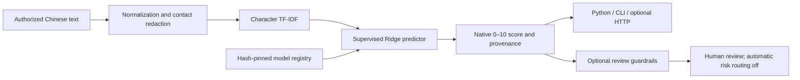

# OpenEssayScore

**Open-Source Chinese Essay Scoring Toolkit** · [中文](README.md)

An independent research toolkit for developers, researchers, and education software teams: supervised Chinese essay scoring, CPU inference, data processing, reproducible evaluation, and optional HTTP serving. No website, production database, proprietary platform, or paid API is required.

This **0.1.0 source release** preserves the historical WenHeng-Score v1 model lineage. It trains a character TF-IDF + Ridge holistic score predictor, not a general-purpose LLM. Scores use the native **0–10** rubric. Cross-grade, cross-prompt, and classroom validity remain unestablished; this is not a teacher-level assessment product.

**Weights are not publicly distributed yet.** The repository contains original source, empty annotation templates, and aggregate results, with no student essays or model binaries. CFMS-34 is publisher-labelled CC BY 4.0 with research-use and human-oversight guidance. Public weight redistribution/use boundaries still require clarification. Authorized artifacts are retained in a private research archive; they are not covered by the source MIT license. Installing the source does not provide a ready-to-score model. Missing artifacts yield readiness 503, never fabricated scores. See [licensing](docs/licensing.md).

## Architecture



The selected scorer requires no GPU, PyTorch, BGE, or remote model API. Semantic features and multitask models remain comparative research. The writing prompt is context metadata; v1 does not measure prompt relevance.

## Install and run

Verified with Linux/Python 3.11; dependency range is Python 3.11–3.12. Not published to PyPI.

```bash
git clone https://github.com/pasariga/OpenEssayScore.git
cd OpenEssayScore
python -m venv .venv
source .venv/bin/activate
python -m pip install -e '.[http,test]'
python -m pytest -q
```

Source-only tests run without weights; artifact-dependent tests explicitly skip. If you already hold an authorized, hash-matching v1 bundle (not supplied here), register it once:

```bash
python -m openessayscore init-v1 --model-dir models/v1 --store workspace/model-store
python -m openessayscore score --store workspace/model-store --text-file authorized-essay.txt --prompt 'Original writing task'
```

```python
from openessayscore import Scorer, ServiceError
scorer = Scorer('workspace/model-store')
result = scorer.score(authorized_text, writing_prompt='Original writing task',
                      authorization_scope='authorized_research', text_verified=True)
print(result['prediction']['overall_score'])
print(result['model']['version'])
```

Never deserialize untrusted joblib/pickle files. The loader verifies pinned v1 hashes before loading. Future incompatible model families require an explicit loader change, validation, and a separate release.

## Optional HTTP API

```bash
python -m openessayscore.service.server --store workspace/model-store --port 8765
curl http://127.0.0.1:8765/health/ready
curl -X POST http://127.0.0.1:8765/v1/score -H 'Content-Type: application/json' \
  -d '{"text":"这是接口连通性测试专用的技术控制文本，不是学生作文，也没有人工评分，请勿用于说明模型准确率。","writing_prompt":"Transport control","authorization_scope":"authorized_research","text_verified":true}'
```

The control text is not an essay accuracy example. Results include native scores, model/weight/preprocessing versions, and review reasons. Confidence, dimension scores, and original-v1 intervals remain null. Default serving is loopback-only. The Python core can also be embedded in Flask or another backend. External authentication, network isolation, and deployment validation remain operator work. See [API](docs/api.md) and [CPU deployment](docs/deployment.md).

## Data and evidence

[CFMS-34](https://github.com/Atiyahsama/HiFTS/tree/933489269eb9dbf5f6f00f8e8be6ba0ccebc3dbb/CFMS-34), by Shihang Yang, Sanwoo Lee, Ningning Zhao, and Yunfang Wu: 951 primary-school Chinese essays, two expert ratings each; official 751/100/100 split. Two 0–5 holistic ratings are summed to 0–10. Publisher licence: CC BY 4.0 with research-use guidance. No dataset is redistributed. Model-generated intermediate feedback is excluded from human targets.

| Experiment | MAE ↓ | QWK ↑ | Scope |
| --- | ---: | ---: | --- |
| Historical v1 character TF-IDF + Ridge | 0.955 | 0.360 | Previously held-out 100 essays; now unblinded |
| R2 lexical | 0.925 | 0.320 | Training-only 5×3 nested title-group CV |
| R2 lexical/semantic fusion | 0.904 | 0.353 | Same internal CV; gain inconclusive |
| R2 shared low-rank multitask | 0.935 | 0.439 | Same internal CV; MAE did not improve |

Official test essays have agreeing raters and observed totals only 6/8/10. They do not represent disputed ratings or low-score coverage. Prompt/student independence is not established. Training MAE was about 0.094, indicating a large generalization gap; high scores are underestimated. Old test results are historical evidence and must not select new models or thresholds. QWK uses clipped 0–10 predictions, `np.rint`, and fixed labels 0…10. [Detailed experiments](docs/experiments.md)

R4 risk AUROC **0.512**, approximately random: reviewing 22.10% captured only 21.54% of large errors. The gate failed; tuning stopped and automatic routing remains disabled. Internal intervals cannot be transferred to v1 or claimed as calibrated per-essay confidence. R5 passed 29 service tests: one logical CPU cold start ~1.30 s, serial P95 ~2.0 ms, four-way P95 8.54 ms, sampled peak RSS ~230 MiB; 16-way requests caused throttling. These are measured cloud CPU results, not universal guarantees.

## GitHub recovery verification

A fresh source clone and private Release download passed all 112 file checksums. In a separate CPU directory, all 43 tests passed; the recovered source built and installed offline as a wheel with identical Python/CLI/HTTP results and no Torch import. These are engineering checks, not new accuracy evidence. [Recovery record](results/github-restore.json)

## Research history and reproduction

[Independent CPU deployment validation](docs/cpu-deployment-validation.md) generalizes the R5 service and R6 protected-shadow preparation. Examples are under `deployment/shadow/`; `tools/docker_hardlimit.py` checks actual kernel limits, cold starts, repeat/concurrent requests, OOM and recovery. **Docker512MiB testing is currently pending an available nonproduction Docker environment.** RSS observations and address-space caps are not substitutes for a passed cgroup hard-limit test. No website or production configuration is required.

R1: supervised scoring and validation-selected v1. R2: audit and nested internal CV, no v2. R3: draft grade-3/4 annotation protocol, no new teacher records. R4: four-role internal risk validation with negative results retained. R5: CPU serving and offline integration. This release adds neutral packaging, interfaces, documentation, backup and recovery checks without retraining or changing v1 weights.

[Reproduction](docs/reproduction.md) · [Lineage](docs/lineage.md) · [Remote GPU development](docs/remote-development.md) · [Backup/recovery](docs/backup-recovery.md)

Original code/docs: [MIT](LICENSE). Data, weights, and dependencies have separate terms: [licensing](docs/licensing.md), [notices](THIRD_PARTY_NOTICES.md). Contribute reproducible code or aggregate evidence via [CONTRIBUTING](CONTRIBUTING.md); never submit student records. Next priorities are authorized dual-teacher data across prompts/grades, independent calibration and sealed evaluation. No stable v2 without that evidence.
