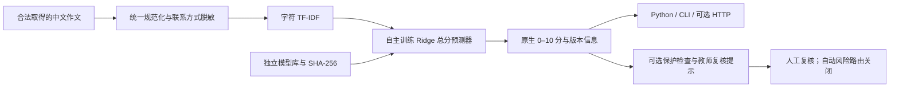

# OpenEssayScore

**Open-Source Chinese Essay Scoring Toolkit · 开源中文作文评分工具包**

[English](README.md) | [简体中文](README.zh-CN.md) · [模型卡](docs/model-card.md) · [实验记录](docs/experiments.md) · [安装与部署](docs/deployment.md)

面向开发者、研究人员和教育软件团队的独立研究工具：数据处理、监督学习评分、CPU 推理、可选 HTTP 服务及离线复核实验。可集成到不同应用，无需任何作文批改网站、数据库或付费模型 API。

当前是 **0.1.0 研究源码首发**，继承历史 WenHeng-Score v1 的字符 TF-IDF＋Ridge 评分器。训练的是中文作文总分预测器，不是通用大语言模型。模型原生分数为 **0–10**，尚未充分验证跨年级、跨题目和真实教学效果，不能替代教师。

> **源码克隆不包含可直接使用的模型权重。** 本仓库公开原创代码、空白标注模板与汇总实验结果；不包含学生作文或模型二进制。数据发布者标注 CC BY 4.0，同时声明研究用途与人工监督。公开权重的用途边界和相关权利仍待确认，独立的 [OpenEssayScore-Archive](https://github.com/pasariga/OpenEssayScore-Archive) 保存研究导出记录及已有 Release 附件；截至 2026-10-24，该 GitHub 仓库实际为公开状态，不能因旧文档称其“私有”就视为受控存储。源码 MIT 许可不覆盖研究归档的模型和数据权利。安装源码本身不会获得评分权重；无权重时就绪检查返回 503，不生成占位分数。详见[许可与数据来源](docs/licensing.md)。

## 项目身份与当前范围

OpenEssayScore 将历史 WenHeng-Score 研究线整理为独立工具包，不是历史妙笔智改（简称智笔，英文标识 ZhiBi）界面，也不是 Vue／FastAPI 文衡应用。该应用采用多提供方 100 分评审协议，本工具保留监督学习的 0–10 分评分器；这里不声称存在经过验证的尺度转换或生产集成。

本轮只整理文档，没有重训、发布权重、重跑基准或确认旧基础设施仍在运行。下文历史结果保留原证据范围。

## 已实现

- Python `Scorer`、离线命令行、可选 FastAPI HTTP 接口，共用预处理、加载与异常处理。
- 历史 v1 权重与向量器 SHA-256 固定；独立模型库、显式版本和回滚、不可覆盖历史评分记录。
- 并发限流、模型缺失/损坏与资源不足处理；默认只监听本机回环地址。
- 解耦复核原型：保护检查可以试验；自动风险分流关闭，置信概率和 v1 预测区间为空。
- 训练及内部验证代码、真实实验汇总、匿名标注表头、按需备份与校验工具。

## 技术架构



语义表示及多任务评分是比较研究，不是默认推理依赖；CPU 服务不加载 PyTorch、BGE 或 GPU。提示题目只作为调用上下文，v1 没有题目相关性判断能力。

## 安装与 CPU 调用

建议 Linux、Python 3.11（已验证），支持的依赖范围为 Python 3.11–3.12。尚未发布 PyPI 包，请从源码安装。

```bash
git clone https://github.com/pasariga/OpenEssayScore.git
cd OpenEssayScore
python -m venv .venv
# Linux/macOS: source .venv/bin/activate
# Windows PowerShell: .venv\Scripts\Activate.ps1
python -m pip install -e '.[http,test]'
python -m pytest -q
```

无权重也能运行源码测试；需要单独权重文件的集成测试会明确跳过。若你已有合法取得、哈希匹配的历史 v1 文件，把它们放在你自己的 `models/v1`，并遵守单独的数据与模型使用条件。**不要加载来历不明的 joblib/pickle 文件。**

```bash
python -m openessayscore init-v1 --model-dir models/v1 --store workspace/model-store
python -m openessayscore score --store workspace/model-store --text-file authorized-essay.txt --prompt '原作文题目'
```

```python
from openessayscore import Scorer, ServiceError

scorer = Scorer('workspace/model-store')
result = scorer.score(authorized_text, writing_prompt='原作文题目',
                      authorization_scope='authorized_research', text_verified=True)
print(result['prediction']['overall_score'])  # 原生 0–10；不是教学结论
print(result['model']['version'])
```

## 可选 HTTP API

```bash
python -m openessayscore.service.server --store workspace/model-store --port 8765
curl http://127.0.0.1:8765/health/ready
curl -X POST http://127.0.0.1:8765/v1/score -H 'Content-Type: application/json' \
  -d '{"text":"这是接口连通性测试专用的技术控制文本，不是学生作文，也没有人工评分，请勿用于说明模型准确率。","writing_prompt":"技术测试","authorization_scope":"authorized_research","text_verified":true}'
```

示例文本只测试传输，无教师分数。响应包括 `contract_version`、原生总分、模型/权重/预处理版本、风险提示；没有维度分数、可信概率或自动纠错结论。Python 核心也可直接在 Flask/FastAPI 中调用；请自行配置受控网络、鉴权和资源隔离，当前原型不是公网服务方案。[完整接口说明](docs/api.md)

## 数据与实验

[CFMS-34](https://github.com/Atiyahsama/HiFTS/tree/933489269eb9dbf5f6f00f8e8be6ba0ccebc3dbb/CFMS-34)：951 篇小学中文作文，双专家评分；官方 train/dev/test 为 751/100/100，每位整体分 0–5，本研究相加为 0–10。发布者为 Shihang Yang、Sanwoo Lee、Ningning Zhao、Yunfang Wu，标注 CC BY 4.0 与研究用途说明。未把 `feedback.csv` 的模型中间反馈当成人工评分；本仓库不转载作文。

| 实验 | MAE ↓ | QWK ↑ | 证据范围 |
| --- | ---: | ---: | --- |
| v1 字符 TF-IDF＋Ridge | 0.955 | 0.360 | 历史独立测试 100 篇，已经揭盲 |
| 第二轮字符方案 | 0.925 | 0.320 | 原训练集内 5×3 嵌套标题分组 CV |
| 第二轮词法/语义融合 | 0.904 | 0.353 | 同上，改善不稳定，未升级模型 |
| 第二轮共享低秩多任务 | 0.935 | 0.439 | 同上，MAE 未改善 |

**测试限制：**官方测试集仅纳入双评分者整体分一致的样本，实际总分只有 6/8/10；不能代表真实分歧作文或完整低分段。题目/学生独立性也未充分核实。v1 训练 MAE 约 0.094，泛化差距明显，高分低估。历史测试集不得重新用于选型或调阈值。QWK 使用截断到 0–10 后 `np.rint`、固定 0…10 类别的二次加权 Cohen kappa。[详细方法](docs/experiments.md)

第四轮风险 AUROC **0.512，接近随机**；复核 22.10% 仅捕获 21.54% 的大误差。未达门槛，已停止调参，自动分流关闭。内部残差区间不能转移为 v1 的外部覆盖保证。第五轮原服务 29 项测试通过；单逻辑 CPU 冷启动约 1.30 秒，串行 P95 约 2.0ms，4 并发 P95 8.54ms，RSS 峰值约 230MiB。16 并发出现限流；这是云端 CPU 实测，不是所有机器的 SLA。

## 研发历程与复现

第五轮CPU服务与第六轮隔离部署准备已整理为[通用CPU部署验证指南](docs/cpu-deployment-validation.md)，相关示例在 `deployment/shadow/`。新增Docker测试入口会核对内核实际内存限额，并覆盖冷启动、重复/并发请求、OOM及恢复。**当前尚未取得可用的非生产Docker环境，512MiB硬限制没有实测通过；既有RSS或虚拟地址空间测试不能代替它。** 这些材料不依赖文衡网站或生产配置。

| 阶段 | 已完成的成果 |
| --- | --- |
| R1 | 真实人工标注监督学习；验证集选型；一次历史测试；保存 v1 |
| R2 | 数据与 QWK 审计；训练集内部嵌套交叉验证；未发布 v2 |
| R3 | 小学三至四年级量规草案、双人评分与封存测试规范；真实新教师记录为 0 |
| R4 | 四角色隔离的内部风险验证；如实保留阴性结果 |
| R5 | 独立 CPU 服务、离线多提供方协作原型、故障与压力测试 |
| 开源整理 | 中立包名、Python/CLI/HTTP、许可隔离、研究归档和恢复验证 |

`research/` 保留历史模块名和实验血缘，安装包只发布 `src/openessayscore`。没有重训或更改 v1 权重。[训练复现](docs/reproduction.md) · [模型血缘](docs/lineage.md) · [云端远程研发](docs/remote-development.md)

## 协作、发布与路线

不同量规和分数尺度没有经过验证的映射时，只能并列展示结果；示例适配器不调用任何付费 API，不简单加权，不改调用方已有结果。未来优先收集合法授权、双人独立评分、跨题目/年级的新数据，另设校准与封存测试，再评估新评分器与风险模块。没有独立证据，不发布稳定 v2。

GitHub 首次恢复验证：历史记录报告重新克隆源码、下载归档，112 个文件校验通过；独立 CPU 目录中 43 项测试通过，并完成 wheel 构建、离线安装及 Python/CLI/HTTP 一致性检查。这些是工程验证，不是新增准确率证据。[验证记录](results/github-restore.json)

原创代码及文档采用 [MIT](LICENSE)；数据、模型与依赖条款分别见 [许可说明](docs/licensing.md)、[第三方声明](THIRD_PARTY_NOTICES.md)。[贡献指南](CONTRIBUTING.md) · [安全说明](SECURITY.md) · [版本记录](CHANGELOG.md) · [备份恢复](docs/backup-recovery.md)
