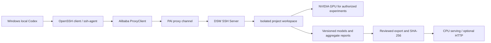

# Remote AI development with Codex and PAI-DSW

This is a reusable architecture description, with no real account, instance identifier, private host alias, credential path or production configuration.

Codex uses the user's existing local terminal and configured SSH connection to execute bounded remote commands. Local machine: planning, source review, Git, documentation, backup and credential-safe orchestration. DSW: dataset processing and authorized compute in the project workspace. Do not silently fall back to a local GPU when remote execution was intended.

OpenSSH performs host-key verification and public-key authentication. A running local ssh-agent holds a previously unlocked identity; Codex need not inspect private-key contents or know a passphrase. If interactive unlocking/login is required, the human completes it locally. ProxyClient provides the configured PAI transport; do not copy its credentials into repository files. Keep TLS/host verification enabled and inspect effective nonsecret connection settings rather than reconfiguring unrelated SSH hosts.

Typical per-session flow: short noninteractive connectivity check, enter the remote workspace and source its existing environment script, inspect Python/dependencies and GPU status only if computation needs it, then execute commands with explicit time/CPU/GPU budgets. Driver-supported CUDA, installed toolkit, and PyTorch runtime CUDA are distinct values. Installing dependencies or starting training is a separate decision, not a prerequisite for every connection.

Persist weights, vectorizers, preprocessing/version metadata, configuration, code hashes and aggregate logs together. Freeze validation-based selection before inspecting a held-out test; preserve negative results. Package only reviewed permitted artifacts. Remove raw student records, per-essay representations, credentials, user paths and restricted upstream weights from outward exports; do not assume a private GitHub repository clears data rights. Generate hashes before transfer, re-download from the backup destination and verify again in a new restore directory.

For CPU deployment, export the selected feature transformer and scorer, not the entire GPU environment. Recreate the compatible CPU dependencies, verify hashes, run parity/input/failure/concurrency checks, then start an isolated loopback service. Release source, model artifacts and contracts with separate version identifiers. A cloud restore smoke test is useful evidence but does not replace testing the intended deployment host. This project uses no paid API as a remote-development dependency.
