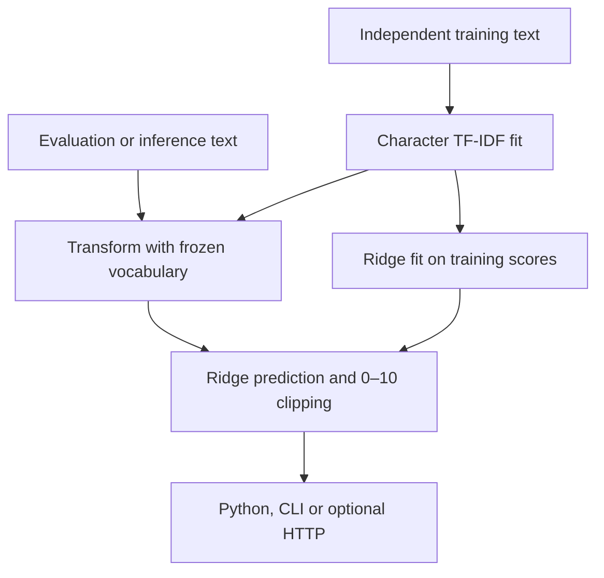

# Synthetic CPU quick start / 合成数据入门

Use Python 3.11 or 3.12 in a fresh virtual environment.

```bash
python -m pip install .
python examples/synthetic_demo.py
```

The example fits character TF-IDF features and a Ridge regressor on six invented Chinese snippets, then scores one additional synthetic snippet. The labels are arbitrary teaching values. The output is a smoke check for the pipeline with zero classroom or model-quality evidence. It uses no remote API, student writing, or redistributed weights.

该示例只用六段原创短文本和人为设定标签，在 CPU 上训练 TF-IDF＋Ridge，然后对独立合成短文执行一次推理。结果只用于核对训练和推理能否跑通。示例模型与历史正式研究模型分开，无法用于真实作文评价。真实模型及 API 的前置条件见[模型卡](model-card.md)与[部署文档](deployment.md)。

## Workflow / 流程



The diagram describes the real historical lexical pipeline. The toy script exercises the fit and inference core. The production-facing research interfaces require the authorized v1 bundle.
